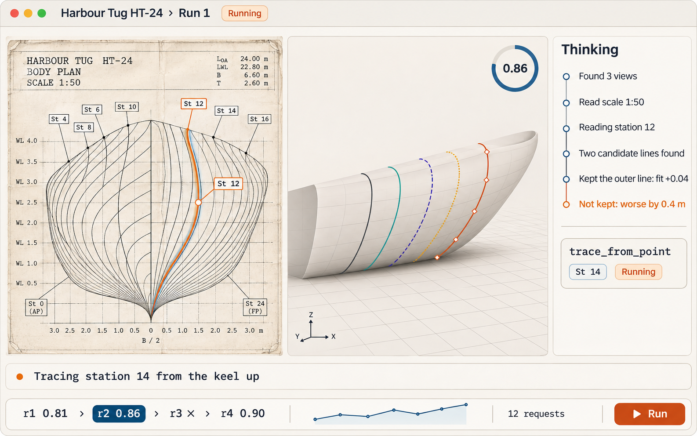
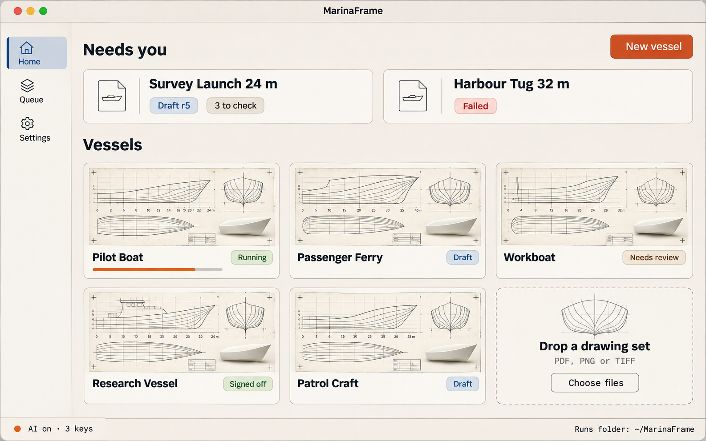

# MarinaFrame app: combined design plan

Date 2026-11-08. Combines four concept lanes (all in `docs/design/`):

| Lane | File | Contribution |
|---|---|---|
| A Storyboard and IA | `2026-11-08-a-storyboard.md` | 18-frame journey, vessel-centred IA, screen inventory |
| B Live agent | `2026-11-08-b-live-agent.md` | moment-by-moment live view, pacing, event and streaming plan |
| C Visual language | `2026-11-08-c-visual-language.md` | three directions, Vellum recommended, component kit, image prompts |
| D Review and trust | `2026-11-08-d-review-workflow.md` | what a naval architect needs to trust a draft, exports, batch |

Resume point: section 7 (build milestones). Images: section 8.

## 1. The product in one line

Drop a drawing set, **watch the agent read it and the hull take shape**, review the few places that
need an expert in minutes, and hand off a labelled draft today; then do the next fifty.

Fixed rules in every screen: every result is a draft (`engineering_approved` is always false; the
words "approved" and "verified" never appear as a status); the AI does not stop on bad data
(problems are warnings and open guesses); chips of one or two words instead of label text; pickers
and buttons instead of typing; nothing overflows.

## 2. Decisions (where the lanes differed)

| Topic | Decision | Why |
|---|---|---|
| Visual direction | **Vellum** (C): paper, ink, drafting blue, one signal orange reserved for AI activity | The drawing is the evidence; long review sessions; honest AI marking; shortest path from today |
| Top object | **Vessel** (A), with a flat vessel list in v1; projects in P1 | Users own vessels and drawing sets, not run specs (A open question 1) |
| Final status words | `Draft`, `Needs review`, `Signed off` (a person's sign-off: "usable as a starting model", D) | C's prompts used "Approved"; that conflicts with the product rule |
| Steering during a run | v1: **Stop** and **Look again** with a short note; edits queue until the run ends (A). Live steering ("that's a grid line") is stage L3 (B) | The controller can pause but the app has no pause command yet (B) |
| The first review need | **Built cuts over the ink with a number per section** (D's #1, F1 overlay) | In real runs the two AI-corrected sections missed the ink by 2-4 m while traced ones fit exactly; the app does not show this yet |
| One-click fix | **Use the traced line** for any AI-changed section (D) | Matches the evidence above; the cheapest high-value correction |
| Cost display | Small, in the run footer; accuracy is the headline | Founder priority 2026-11-08 |
| 3D look | Matte "drafting resin" hull, section ribbons coloured and patterned by source label, zebra toggle from Graphite | C; colour is never the only signal |

## 3. Information architecture (from A, adjusted)

Objects: Vessel → Sheets (pages; views: body plan, half-breadth, profile, title block) → Runs →
Revisions (r1, r2 …; author code / agent / you) → current Draft → Artifacts.

Navigation: narrow left rail (Home, Queue, Settings); title-bar breadcrumb Vessel › Run › rN;
vessel tabs **Sheets | Run | Compare | Export | History**; command palette (⌘K).

Screens and priority:

| Screen | Priority | Frames (A) |
|---|---|---|
| Welcome and setup check (AI key, CAD worker, runs folder; continue without AI) | P0 | F1-F2 |
| Home: "Needs you" row + vessels; one large drop target | P0 | F3, F18 |
| Intake: sheet tray, auto view labels (survey_sheet), particulars, Start reading | P0 | F4 |
| Run, Live mode (section 4) | P0 | F5-F10 |
| Run, Review mode: same panes, "What to check" list, inspector, section strip | P0 | F11-F14 |
| Export: STEP, STL, offsets CSV, hydrostatics, PDF report, package | P0 | F16 |
| Settings (developer paths under Advanced) | P0 | — |
| Queue (many vessels, parallel runs, morning review) | P1 | F17 |
| Compare revisions or runs | P1 | F15 |
| Cross-view overlays (half-breadth, profile) | P1 | F13 |
| History, edit points, sample vessel | P2 | — |

## 4. The live run (from B, staged)

Layout: drawing (left, large) with an **attention layer**; 3D (right) with a fit dial; a two-line
**narration strip** under both; the inspector's **Thinking** tab; a control bar (Stop, Look again,
speed and scrub for replay, Accept draft).

On the drawing: view boxes draw in turn after the survey; dimensions pin to where they were read;
an attention ring follows each crop the model asks for; enumerated strokes light up with tags;
clicks ripple, corridors show as bands, refusals turn amber with their reason in place; a chosen
line snaps to its station pin; repeated steps collapse ("Read the labels again, 3 times").

In 3D: the first hull's sections slide in station by station at their x, coloured and patterned
by source label; the skin fades in between finished stations; each kept model edit flashes its
region; the fit dial ticks per revision; rejected edits show "Not kept: worse by 0.4 m".

Thinking: one card per model step quoting its `reason`; `notes` and (when enabled) thinking text
collapsed under "Why"; tool calls as compact cards (tool, target chip, duration, result chip).

Stages: **L1** replays the existing ledger and build files with timing (also gives replay/scrub of
finished runs); **L2** event streaming from a file watcher instead of 500 ms polling, plus worker
progress during the ~155 s first-hull build; **L3** live steering and thinking text in receipts.

## 5. Review and trust (from D)

What a naval architect needs, in order: (1) built cuts over the ink with a fit number per section;
(2) where each section's shape came from, on the body plan, the strip and the 3D model; (3) flags
on sections that disagree with the ink, worst first; (4) fairness along the length (waterline
half-breadths, sectional-area curve); (5) main dimensions and hydrostatics against the drawing.

P0 review features: ink overlay in the app; disagreement flags; one-click "Use the traced line";
review queue sorted by ink agreement; sign-off record with notes ("usable as a starting model");
offsets CSV; hydrostatics summary; dimension check; PDF review report with overlays and source
labels; batch run of a folder of sheets; a "Draft, not for construction" stamp on every export.

## 6. Visual system (from C, Vellum)

Tokens (light / dark): paper `#F4F1EA`/`#14181E`, surface `#FBFAF6`/`#1A1F27`, ink
`#1D2430`/`#E8E4DA`, drafting blue `#1F4E79`/`#6FA3D6` (selection, focus), signal orange
`#D9532B`/`#F0703F` (AI activity and the one primary button only), warn amber `#A86A12`.
Source labels: traced solid ink, repaired teal with ticks, interpolated indigo long dash,
ai_inferred amber dotted, ai_corrected orange with diamond nodes; each also has a chip glyph.
Type: IBM Plex Sans / Plex Mono (OFL, bundled). Motion explains change only: pen-stroke draw-in
400 ms, skin growth 600 ms, stream fade 120 ms; off under reduced motion. Component kit as in C.

## 7. Build milestones (lanes with separate files)

| Milestone | Content | Main files | Done when |
|---|---|---|---|
| M1 Shell and look | Vellum tokens, fonts, app shell, rail, breadcrumb, chips, empty states; Home with drop target; Settings with Advanced | `app/ui/styles.css`, `index.html`, `js/app.js` shell parts | Screenshots at 3 sizes, both themes, match the Vellum images; no overflow |
| M2 Intake | Multi-page drop (PDF/PNG/TIFF), page render, survey_sheet preview, view labels, spec writer | `app/core` intake module, Tauri command, `js/intake.js` | Drop a 3-page PDF and start a run without seeing a spec file |
| M3 Live L1 | `get_live_steps` (incremental, compact), attention layer, narration, Thinking cards, 3D station-by-station growth from `result.json`, replay/scrub | `app/core/src/live.rs`, `js/live.js`, `js/model3d.js` | A finished run replays with every key moment of section 4 |
| M4 Review P0 | ink overlay with fit numbers, flags worst-first, Use the traced line, What to check, sign-off record | `app/core/src/review.rs`, `js/review.js`; controller operator action | A reviewer fixes the dtmb5415-L0 AI sections in 2 clicks |
| M5 Export P0 | offsets CSV, hydrostatics, PDF report, package, draft stamp | `src/vessel_reconstruction/exports/`, Tauri command, `js/export.js` | Export files open in Excel / a CAD viewer / a PDF reader |
| M6 Live L2 + Queue | file-watcher event stream, worker progress, batch queue, notifications | `app/src-tauri` watcher, `app/core` queue | Drop 6 sets; watch them run; morning review list |
| M7 Compare, L3 steering | compare revisions; pause and steer; thinking text | controller pause command, `js/compare.js` | — |

M1, M2 and M5 can start in parallel; M3 needs M1's shell; M4 needs M3's overlay layer.

## 8. Images

Concept images are generated from lane C's prompts (corrected: no "Approved" chip; status bar
"AI on · 3 keys" instead of "Local models ready"). Files go to `docs/design/images/` when exported;
the chat links are recorded here.

Generated (ChatGPT Images, Extra High, 2026-11-08, 1586 × 992):

| Screen | Chat | Notes |
|---|---|---|
| Live run (Vellum) | https://chatgpt.com/c/6af096ae-607c-83ec-90b5-67d5ee82a736 | body plan with attention ring on St 12; hull forming with coloured section ribbons; Thinking list with an amber "Not kept" line; fit dial 0.86; revision ladder |
| Home (Vellum) | https://chatgpt.com/c/6af096cf-29e4-83ec-8402-711c72c22db0 | "Needs you" row; vessel cards with drawing + hull thumbnails and status chips; drop-a-drawing-set tile; "AI on · 3 keys" |

Files: `images/vellum-live-run.png`, `images/vellum-home.png` (downloaded by the founder from the
chats above).

## 9. Palette change: MarinaChain brand (founder, 2026-11-08)

Keep the Vellum structure; use the MarinaChain brand tokens (source: the MarinaChain website design
system, `marinachain-website-revamp-2026/docs/HANDOVER-DESIGN.md` and `design-system.md`).

| Role | Light | Notes |
|---|---|---|
| Paper / background / cards / accent bg | `#FBFBF9` / `#FCFCFD` / `#F2F4F7` / `#EFF8FF` | brand neutrals |
| Ink / muted | `#101D30` / `#7F899C` | |
| Primary action, selection, focus | MarinaChain blue `#06448E` (hover `#0A57B4`) | replaces drafting blue and the orange primary button |
| "AI acted here" (reserved) | teal `#07AF87` | brand product-UI colour; replaces signal orange |
| Needs review / warnings | amber `#8A6A1E` on `#FDF3DC` (dark: `#F5B14C`) | brand rule: amber only for review data |
| Dark mode base | navy `#0A1F3D` with lighter navy surfaces | brand dark band |
| Source labels | traced ink solid; repaired navy `#004557` ticks; interpolated `#7AA2D6` long dash; ai_inferred amber dotted; ai_corrected teal diamonds | patterns and glyphs stay |

Type: Manrope (the brand's product-frame font, OFL) for the UI, IBM Plex Mono for numbers.
No orange anywhere. The concept images in `images/` use the earlier orange Vellum palette.
